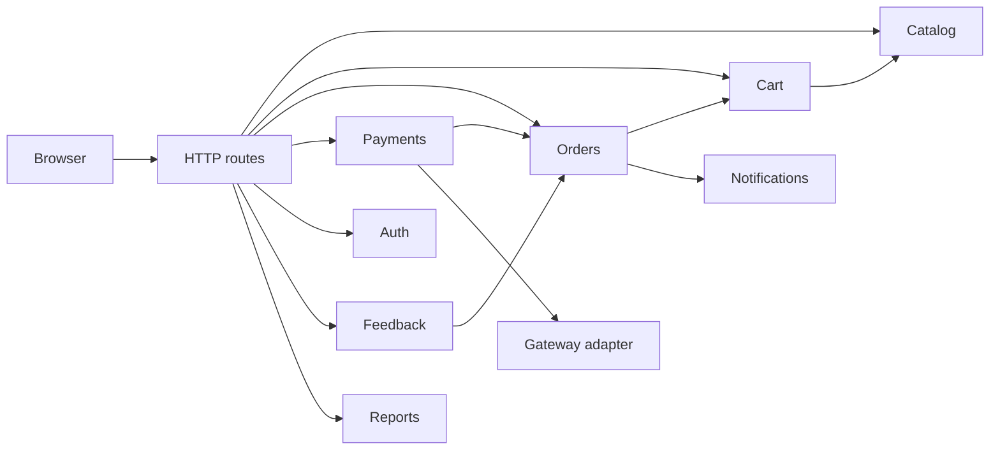
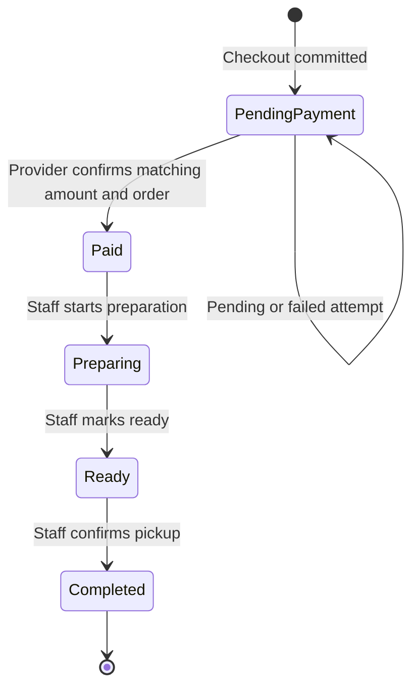

# Requirements and design

## Baseline and elicitation

The supplied *Sketch Café Online Ordering System SRS v1.0* is the requirements baseline. The class, use-case, sequence and DFD diagrams are design evidence. SRS §1.2 excludes pickup-slot scheduling, so the separate use-case diagram's **Select Pickup Time** step is omitted. §3.2.4 supplies the customer's name requirement in addition to the phone shown on the sequence diagram. §3.2.10 allows standalone support, so a request may link to zero or one order. The Level 0 DFD is treated as the context diagram and the supplied Level 1 DFD as its decomposition.

Elicitation for this build used document analysis and a walkthrough of the customer, staff and admin flows. An interview with the café manager would confirm the opening hours, UPI and messaging providers, and desired report definitions. A staff observation session would validate how orders enter the preparation queue. These are proposed activities.

## MoSCoW and traceability

Priorities are for the course demonstration. The source SRS still describes the full product. SRS §5 supplies the numbered acceptance criteria (ACs).

| ID | SRS | Priority | Demo feature and module | Acceptance or evidence |
| --- | --- | --- | --- | --- |
| FR-01 | §3.2.1 | Must | Employee sign-in, sign-out, change password, idle expiration and server-side roles in `auth` and `http` | AC 10–11, auth and HTTP tests |
| FR-02 | §3.2.2 | Must | Browse, keyword/category search, details and availability in `catalog` | AC 1, catalog and browser checks |
| FR-03 | §3.2.3 | Must | Session cart, quantities, live totals and unavailable-item handling in `cart` | AC 1–2, cart tests |
| FR-04 | §3.2.4 | Must | Valid guest details, one order per cart, order snapshots in `orders` | AC 3, 8–9, order and HTTP tests |
| FR-05 | §3.2.5 | Must | Simulated UPI attempts, server verification, failure and retry, receipt in `payments` and `demo-gateway` | AC 4–5 in demo mode, payment and HTTP tests |
| FR-06 | §3.2.6 | Must | Code plus phone tracking, timestamped history and in-app notification inbox in `orders` and `notifications` | AC 6 in demo mode, status and browser checks |
| FR-07 | §3.2.7 | Must | Paid-only queue, sequential states and availability updates | AC 7, order and HTTP tests |
| FR-08 | §3.2.8 | Must | Category, item and price management with archived rows and immutable order prices | AC 9, catalog and order tests |
| FR-09 | §3.2.7, §3.2.9 | Should | Filtered order history, staff management, daily sales and date-range reports | Auth, reports and browser checks |
| FR-10 | §3.2.9–10 | Should | One review per completed order, support lookup, replies and resolution | AC 12, feedback and HTTP tests |
| FR-11 | §3.2.2, §3.2.8 | Could | Optional HTTPS menu image URL | Catalog validation |
| FR-12 | §3.1, §3.2.5–6 | Won't this iteration | Live UPI, phone notifications and receipt delivery | Needs provider credentials, sandbox and end-to-end provider tests |
| NFR-01 | §3.3 | Must | Local menu/cart latency and five-second staff refresh | Load check and browser walkthrough |
| NFR-02 | §3.5 | Must | Password hashing, protected sessions, role boundaries, atomic and repeatable checkout/payment | Unit and HTTP security checks |
| NFR-03 | §3.5 | Should | Responsive guest pages and SQLite backups | Mobile-width browser check and documented backup procedure |
| NFR-04 | §3.5 | Won't this iteration | Deployed HTTPS, notification-provider handoff within 30 seconds, 95% opening-hours availability | Requires deployment and measurement |

## Modularity, cohesion and coupling

| Module | Cohesive responsibility | Direct collaboration |
| --- | --- | --- |
| `catalog` | Current menu, price, categorization and availability | SQLite adapter |
| `cart` | Editable cart lines and current totals | Catalog availability and SQLite adapter |
| `orders` | Checkout snapshots, ownership lookup and fulfillment state | Cart read model, notification recorder and SQLite adapter |
| `payments` | Start/resume an attempt and verify results once | Order lookup/confirmation, injected gateway and SQLite adapter |
| `demo-gateway` | Emulate provider-owned outcomes and references | Separate provider table through SQLite adapter |
| `notifications` | Record and read customer-visible status messages | SQLite adapter |
| `auth` | Account lifecycle, credentials, sessions and role checks | SQLite adapter and injected clock |
| `feedback` | Reviews, support requests and replies | Order ownership lookup and SQLite adapter |
| `reports` | Date-bounded paid sales, item ranking and daily counts | Read-only queries through SQLite adapter |
| `database` | Schema, prepared statements and transaction boundary | Node SQLite |
| `http` / `app` | HTTP and role dispatch / dependency composition | Feature services |
| `public` | DOM views, input feedback, polling and API calls | JSON contract |

Feature modules take explicit IDs, values and service dependencies. Data coupling appears in calls such as `catalog.item(itemId)`. Stamp coupling is limited to read models such as the order snapshot passed to the notification recorder. Payment verification depends on the gateway interface and the order confirmation operation. Orders have no reverse dependency on payments. The demo outcome control is separate from the verification request, so a status supplied to the verification endpoint cannot mark an order paid. The composition root supplies the clock and gateway, so module tests can simulate elapsed time and provider errors without HTTP.

SQLite is deliberately shared to preserve consistency. Some queries read across feature-owned tables, especially reports and the staff queue. Schema changes to these tables require updates to those queries. The shared database handle exposes query/transaction operations. Explicit dependencies and table constraints keep the trade-off visible. The HTTP layer checks the role before it invokes a protected feature. The two employee roles use one account representation with a role field and separate permissions.

All feature services use the SQLite adapter where persistence is needed. The composition root provides the dependency instances.

## DFD and sequence mapping

| Supplied Level 1 process | Implementation | Main stores |
| --- | --- | --- |
| 1.0 Menu and cart | Catalog and cart services | D2 menu, plus cart and cart items |
| 2.0 Order management | Checkout, order snapshots and tracking | D1 orders, lines and status events |
| 3.0 Payment processing | Payment attempts and simulator adapter | D4 payment attempts and demo-provider records |
| 4.0 Notifications and feedback | Inbox, reviews, support and replies | D5 feedback, plus notifications |
| 5.0 Café operations | Staff role routes for order stages and availability | D1 orders and events, D2 availability, D4 verified payments |
| 6.0 Administration | Admin role routes for menu, staff, reporting and feedback | D1–D5 |

At the context boundary, guests exchange orders, payments, status and feedback with the app. Staff exchange order and availability updates. Admins exchange menu, staff, reports and feedback. The simulated provider supplies a transaction result; the local inbox represents the customer notification channel. In the supplied sequence, the gateway is consulted after order creation. The implementation follows that order, with an explicit verification call that reloads the provider record before confirming the order.

## State transition diagram

Only verified success enters the queue. An order code and mobile number authorize guest reads. One cart creates at most one order. Payment verification and its order transition, history and receipt notification share a transaction. Unique indexes limit each order to one pending and one successful payment. Retrying verification of a terminal result returns the existing result. A retry after failure creates a separate attempt. Staff transitions each write a history event and message in one transaction. Current prices are stored in integer paise and copied to order lines at checkout. Menu items and categories are archived to preserve historical references.

## Coding and operational constraints

Use named feature factories, parameterized SQL, explicit validation at the HTTP and feature boundaries, UTC timestamps with IST date grouping, and text nodes for user-entered text in the browser. Keep external calls out of the SQLite transaction when adding real providers. A production gateway would require asynchronous requests, provider idempotency keys and authenticated result reconciliation. A notification worker would read committed inbox/outbox records and persist delivery attempts. The synchronous gateway interface in this demo assumes a local adapter.

The app uses Node.js 24+, SQLite and a modern browser. It binds to localhost and uses demo accounts. The admin inbox and staff history show up to 200 recent matching records. Real provider credentials, TLS, external backups and a deployment environment are needed to validate the production quality attributes.
