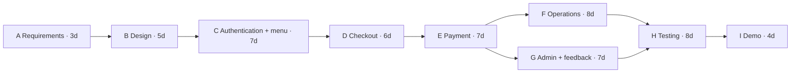

# Project management

## Feasibility

| Aspect | Assessment |
| --- | --- |
| Technical | The local browser, Node.js and SQLite stack can demonstrate the full guest-to-pickup loop on one laptop. Payment and notification behavior is reproducible using simulated outcomes and the local inbox. |
| Operational | Guests need a mobile number and an order code. Staff need a browser open during service. The demo uses one café, counter pickup and a single administrator. |
| Economic | The demo uses existing equipment and zero external packages or service subscriptions. Live hosting, payment, messaging and backups have separate costs that depend on provider selection. |
| Schedule | The following PERT baseline fits within the SRS's three-month window under the stated staffing and parallel work assumptions. |

## PERT, cost and critical path

This is a planning estimate for coursework. Assume two contributors, five workdays per week and three focused hours per person per assigned day. Each activity has one owner. Optimistic (O), most likely (M) and pessimistic (P) values are in workdays. Expected time is (O + 4M + P) / 6.

| ID | Activity | Predecessor | O | M | P | Expected | Earliest finish | Slack |
| --- | --- | --- | ---: | ---: | ---: | ---: | ---: | ---: |
| A | Elicit requirements, SRS and priorities | — | 2 | 3 | 4 | 3 | 3 | 0 |
| B | Model roles, DFD, data and order states | A | 3 | 5 | 7 | 5 | 8 | 0 |
| C | Build authentication and menu | B | 5 | 7 | 9 | 7 | 15 | 0 |
| D | Build cart and checkout | C | 4 | 6 | 8 | 6 | 21 | 0 |
| E | Build and verify the payment flow | D | 4 | 7 | 10 | 7 | 28 | 0 |
| F | Build staff queue, tracking and notifications | E | 5 | 8 | 11 | 8 | 36 | 0 |
| G | Build reports, staff accounts and feedback | E | 4 | 7 | 10 | 7 | 35 | 1 |
| H | Execute regression and acceptance checks | F, G | 5 | 8 | 11 | 8 | 44 | 0 |
| I | Rehearse and package the demo | H | 2 | 4 | 6 | 4 | 48 | 0 |

The critical path is **A → B → C → D → E → F → H → I**, with 48 workdays. The two branches after E can run in parallel. Total effort is 55 person-days or 165 focused hours under these assumptions. At a hypothetical ₹250 per hour, the effort estimate is ₹41,250. Using a 60-workday planning window leaves 12 workdays of schedule reserve.

## Monitoring and control

| Checkpoint | Acceptance evidence | Control action |
| --- | --- | --- |
| End of core ordering | Guest order and verified receipt, failure retry, role checks | Triage blockers before adding features. Keep payment and notification provider decisions in the scope log. |
| End of operations | Staff queue, valid transitions, timestamped history and Ready message | Compare actual work with the PERT baseline. A slip in F shifts testing unless reserve is used. |
| Before hand-in | Unit and HTTP suites, browser walkthrough, load result, setup instructions | Re-run acceptance checks after fixes. Record open provider and deployment gaps in the release notes. |

Use a weekly tracker with owner, planned finish, actual finish, evidence and blocker. Keep a change log that records the requirement ID and the design and test cases affected by each change.
